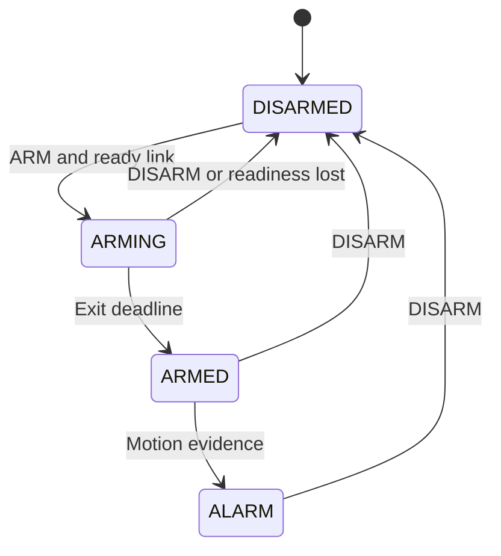

# Architecture

## Responsibilities

`app_main()` calls `alarm_app_run()` with the node's role. Both firmware projects compile the shared components. The detector reads GPIO27; the panel reads its buttons and controls GPIO25 and the OLED.

The portable core has no dependency on ESP-IDF. `alarm_protocol.c` serializes and validates packets; `alarm_logic.c` owns input filtering, panel transitions and transmission deadlines. `alarm_app.c` supplies real time, GPIO readings and radio delivery. This allows deterministic computer-side tests with simulated time and packet loss.

## Panel transitions

Motion already HIGH at the exit deadline triggers ALARM immediately. CLEAR cannot clear a latched alarm. Link health and fault state are tracked independently of mode, so ALARM can coexist with an offline detector. An offline armed panel remains armed; it cannot detect new motion while disconnected. A detected peer restart during ARMING/ARMED records a restart fault and cancels an active countdown. DISARM clears the recorded fault but does not manufacture a healthy connection.

## LED output

The LED is active-high on GPIO25. Only `PANEL_ALARM` requests HIGH. Startup, DISARMED, ARMING and ARMED request LOW. Link faults alone do not light or blink it; the OLED carries fault information.

The output module remembers the last successfully commanded level. A failed write leaves that value intact, allowing the next loop to retry both ON and OFF transitions. A successful driver call confirms that a command was accepted, not that an LED is physically connected or illuminated.

## Scheduling and ownership

The control task polls at a nominal 5 ms interval and owns the alarm state and LED. ESP-NOW callbacks copy incoming data into a bounded queue and release the transmit gate on send completion. They do not render the screen or run the state machine. The main loop processes at most eight received events per pass, and ACKs have transmit priority.

The OLED task receives a copy of the latest panel state through a one-slot mailbox. It renders a 1024-byte framebuffer and sends changed pages. `ui_frame.c` handles pixels, `oled_wire.c` constructs controller packets, and `panel_display.c` handles the I2C driver and recovery. The display task's timeout refreshes countdown text; new states wake it without waiting for that timeout.

## Time constants

| Constant | Value | Purpose |
| --- | --- | --- |
| Control period | 5 ms | Input/control scheduling |
| Sensor stability | 20 ms | Accept a stable input change |
| Button stability | 25 ms | Debounce controls |
| PIR warm-up | 60 s | Ignore startup sensor events |
| Exit countdown | 10 s | Delay entry into ARMED |
| Heartbeat | 500 ms | Refresh status during inactivity |
| ACK timeout | 120 ms | Retry a pending snapshot |
| Attempts | 3 total | Bound per-snapshot transmissions |
| Link timeout | 2500 ms | Detect stale status/ACKs |

New input state supersedes a pending heartbeat immediately. The cumulative motion count retains event evidence when snapshots are coalesced. Both a recent peer STATE and a recent matching application ACK are needed for healthy link status. See [protocol](../PROTOCOL.md).

## Reading order

Start with `panel/main/main.c`, `board_config.h`, `alarm_logic.h`, and the panel functions in `alarm_logic.c`. Next read `panel_outputs.c`, the protocol pair, and finally `alarm_app.c`. The tests provide executable examples of each rule. Headers declare interfaces; source files implement them; component CMake files register sources and dependencies.
